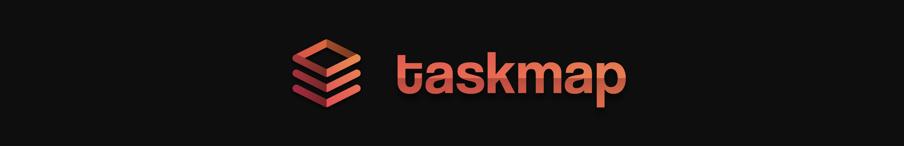
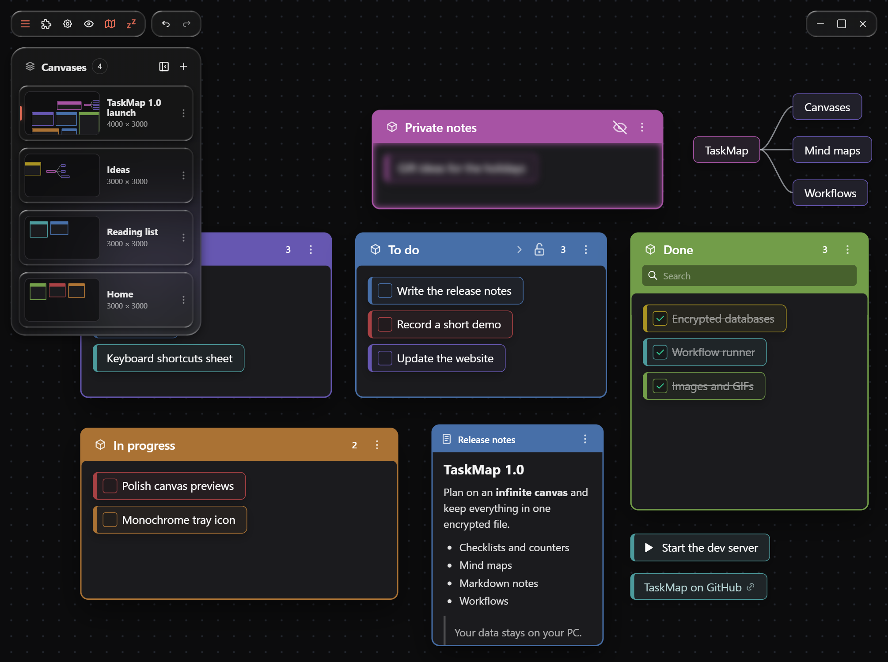

<div align="center">



<p><strong>Local canvas to organize your tasks, notes and ideas.</strong></p>

<p>
  <a href="https://github.com/MerkDesigns/TaskMap/releases/latest">
    
  </a>
  <a href="https://github.com/MerkDesigns/TaskMap/releases">
    
  </a>
  
</p>

<p>
  <a href="https://github.com/MerkDesigns/TaskMap/releases/latest/download/TaskMap_1.0.0_x64-setup.exe">Download for Windows</a>
  ·
  <a href="https://github.com/MerkDesigns/TaskMap/releases">View all releases</a>
  ·
  <a href="CHANGELOG.md">Changelog</a>
</p>

</div>



## What is TaskMap?

TaskMap is a desktop canvas for planning visually. Lay out boards, checklists, notes and mind maps
side by side, spread your work across as many canvases as you like, and move freely between them.
Everything lives in a single database file on your computer, locked with a password you choose —
no account, no cloud, no tracking.

## Highlights

**Plan on a canvas**

- **Infinite canvases** — pan and zoom smoothly, and keep separate canvases for every project. The
  canvas browser shows a live preview of each one.
- **Containers and cards** — group text cards into lists, drag them between containers and reorder
  them. Turn a container into a checklist, count its cards or search them.
- **Mind maps** — hold <kbd>C</kbd> and drag from a node to grow a branch; connect any two nodes.
- **Markdown notes** — text blocks render headings, lists, quotes, code and links.
- **Images and GIFs** — drop them onto the canvas or into a container.
- **Workflows** — give a card a play button that starts your tools, like `npm run dev` in a
  terminal. Workflows you didn't write are shown for review before they can run.

**Stay in control**

- **Extensions where you need them** — checkboxes, counters, search, locking, privacy blur, colour
  pickers and more, added per element instead of everywhere.
- **Alignment snapping, multi-select and layers** — hold <kbd>Shift</kbd> while moving or resizing
  to snap to nearby edges.
- **Undo and redo** for every edit, plus copy and paste of whole groups of elements.
- **A calm interface** — glass toolbars that step out of the way after a moment (sleep mode), a
  minimap for big canvases, and a background colour of your choice.

## Your data stays yours

- **One encrypted file.** Your canvases are stored in a `.tmapdb` database protected by your
  password (Argon2id key derivation, XChaCha20-Poly1305 encryption). Without the password the
  content can't be read.
- **Local only.** TaskMap never uploads your data. Keep the file wherever you like and back it up like
  any other file.
- **Privacy mode** hides the window from screenshots and screen sharing; the privacy extension blurs
  individual containers and notes.
- **Keep it unlocked in the tray** if you like, with an optional timer that locks it again.

Images and GIFs are stored in the same file but not encrypted, so they load quickly. The full
security model is described in [docs/SECURITY.md](docs/SECURITY.md).

## Getting started

1. Download the installer from the [latest release](https://github.com/MerkDesigns/TaskMap/releases/latest)
   and run it. It installs per user, without an administrator prompt.
2. Create a database and choose a password. There is no way to recover a forgotten password, so keep
   it somewhere safe.
3. Press <kbd>Tab</kbd> to open the canvas browser, right-click the canvas to add elements, and
   start planning.

### Shortcuts

| Action                           | Shortcut                                      |
| -------------------------------- | --------------------------------------------- |
| Open or close the canvas browser | <kbd>Tab</kbd>                                |
| Cycle through canvases           | <kbd>Ctrl</kbd> + <kbd>Tab</kbd>              |
| Open the quick extensions menu   | <kbd>Shift</kbd> + <kbd>E</kbd>               |
| Pan / zoom                       | Middle drag / mouse wheel                     |
| Box select                       | Left-drag on empty canvas                     |
| Snap while moving or resizing    | Hold <kbd>Shift</kbd>                         |
| Connect or grow a mind map       | Hold <kbd>C</kbd> and drag from a point       |
| Undo / redo                      | <kbd>Ctrl</kbd> + <kbd>Z</kbd> / <kbd>Y</kbd> |
| Delete the selection             | <kbd>Delete</kbd>                             |

All shortcuts are also listed in **Settings → Shortcuts**.

## Building from source

TaskMap is built with [Tauri 2](https://tauri.app), React and TypeScript, with storage, encryption
and workflows in Rust. You need Node.js, the Rust toolchain and the
[Tauri prerequisites for Windows](https://tauri.app/start/prerequisites/).

```bash
npm install
npm run app:dev       # run the development build (TaskMap Beta)
npm run check         # formatting, types, lint, tests and boundary checks, as in CI
npm run bundle:stable # build the Windows installer
```

The development build installs as **TaskMap Beta** and keeps its own settings and databases, so it
runs next to a regular TaskMap install. Architecture and contribution notes live in
[ARCHITECTURE.md](ARCHITECTURE.md) and [docs/](docs/).
